# Ariadne

**The engineering thread for small and medium-sized engineering companies — a configurable ALM/PLM backbone for
requirements, architecture, verification, documents, variants and change.**

Ariadne connects requirements, architecture, verification, documents, variants and changes in one versioned,
traceable and auditable system. It adopts the proven concepts of enterprise suites (live documents, suspect links,
revisions and maturity states, closed-loop change management, baselines, feature-based variants) and delivers
them in two containers, without enterprise licence and operating costs. *(Repository and technical code name:
ALMlight.)*

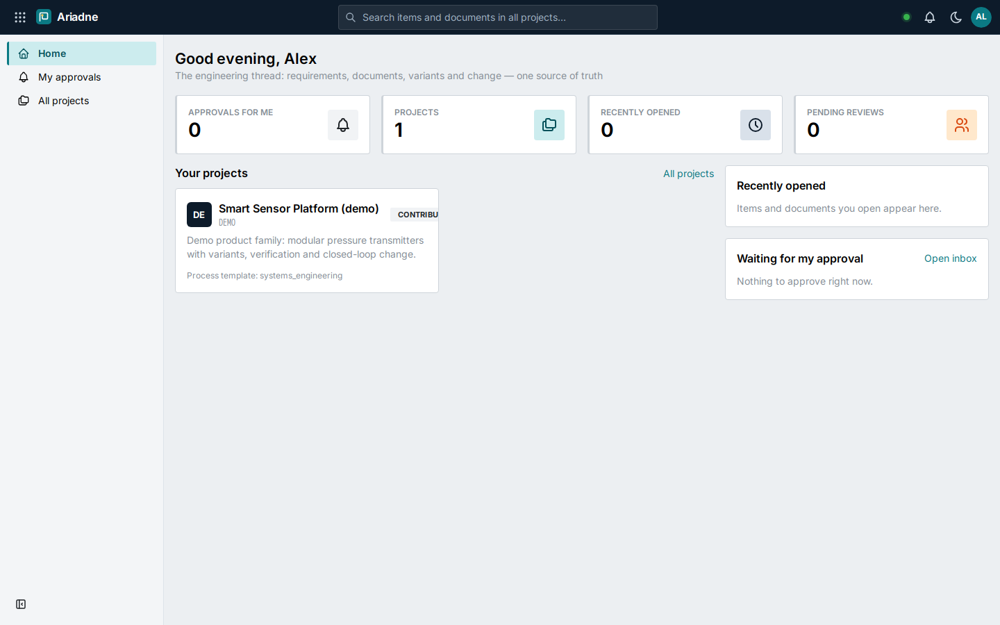

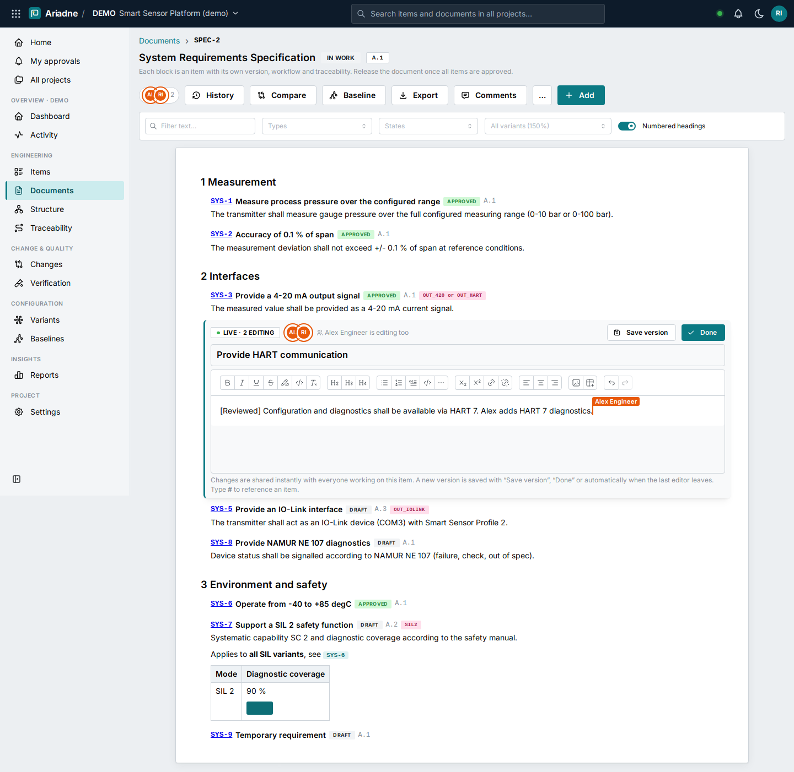

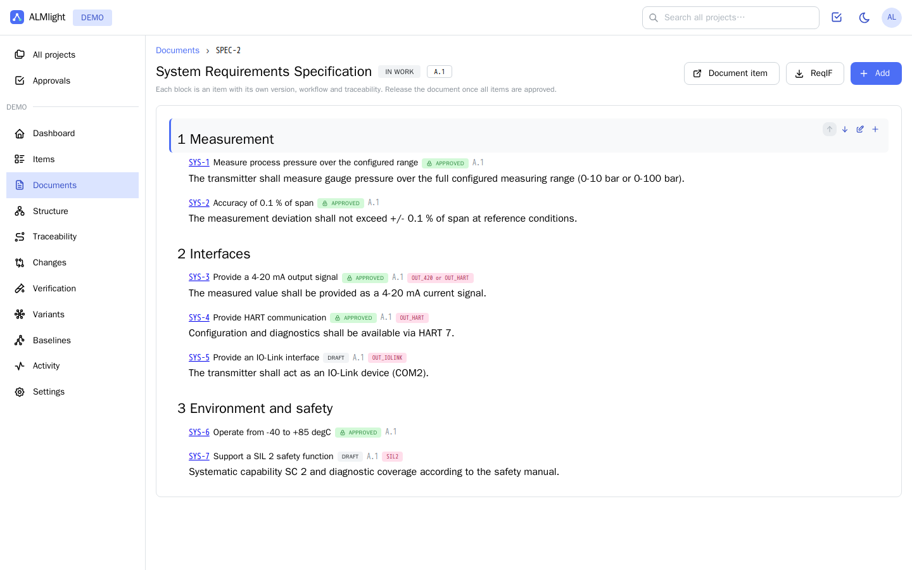


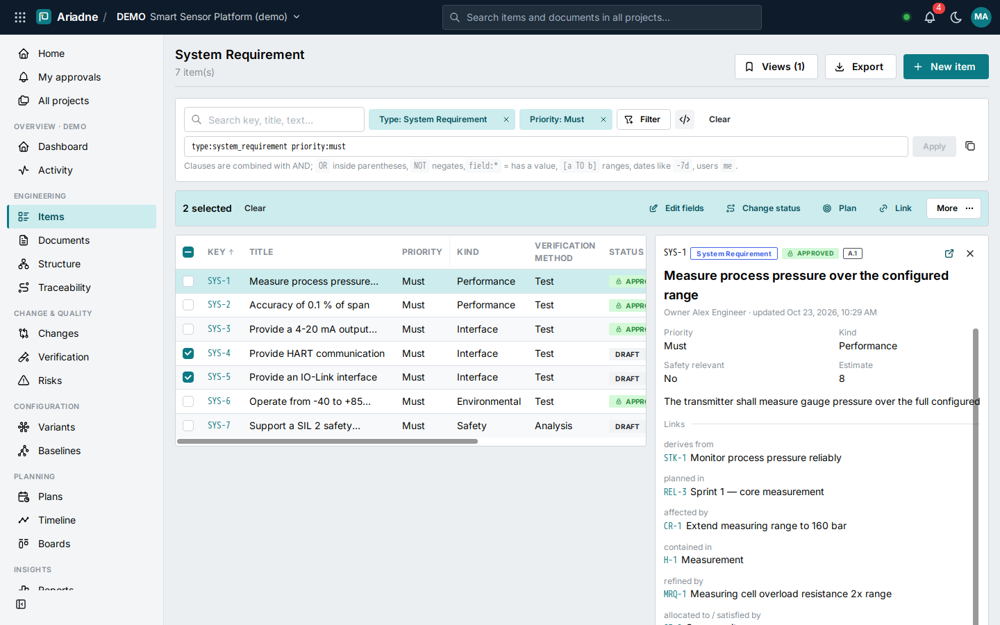

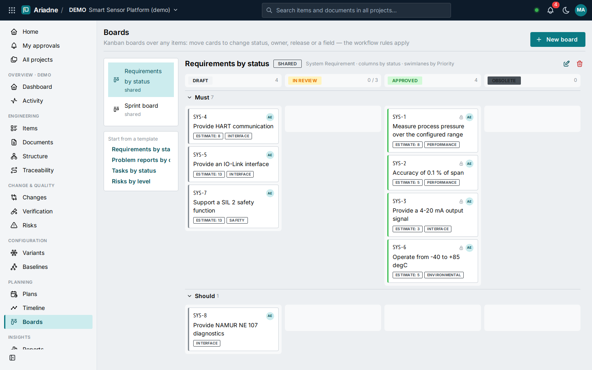

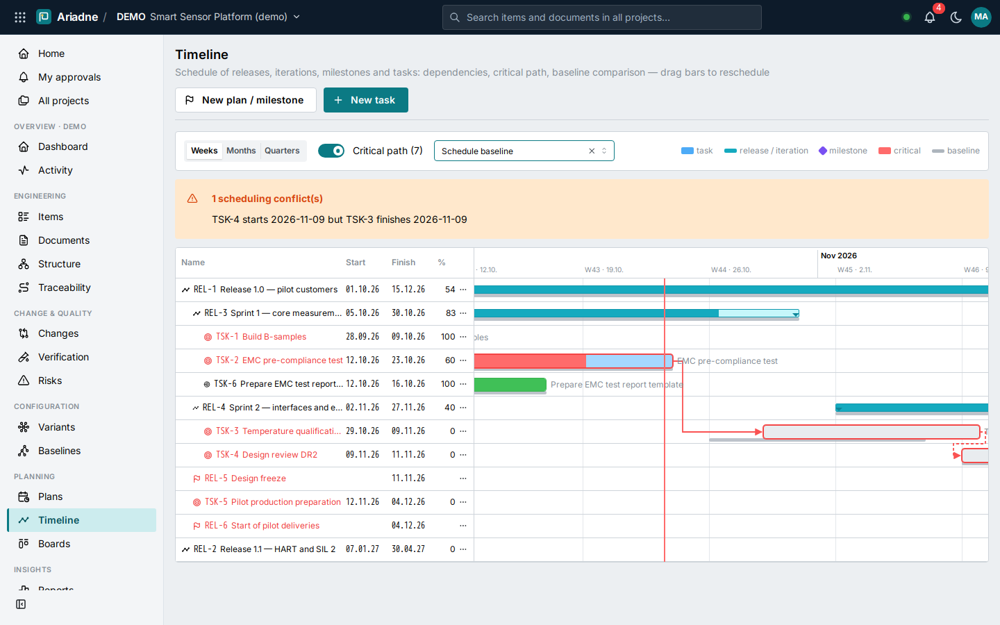

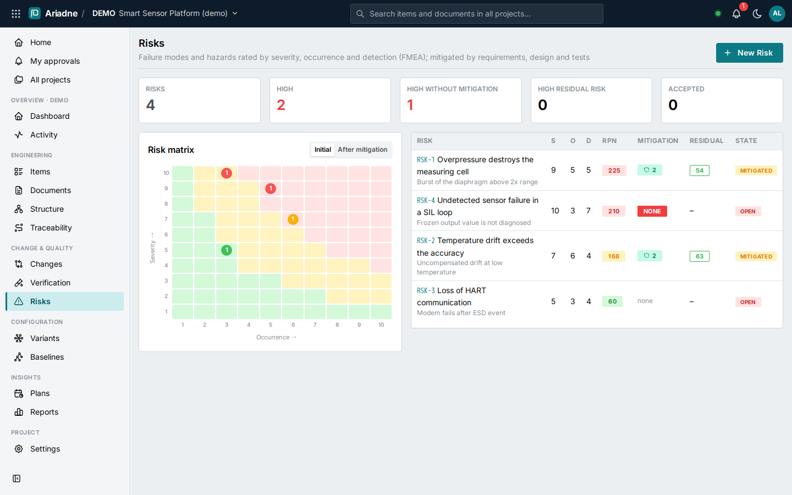

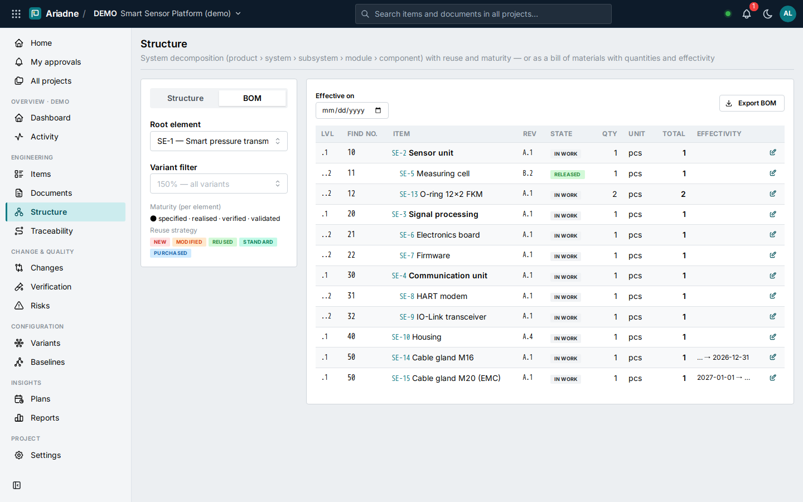

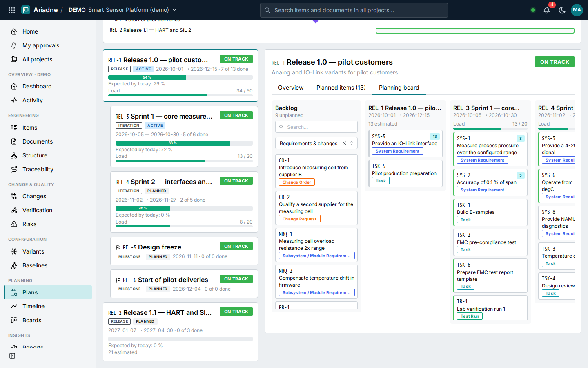

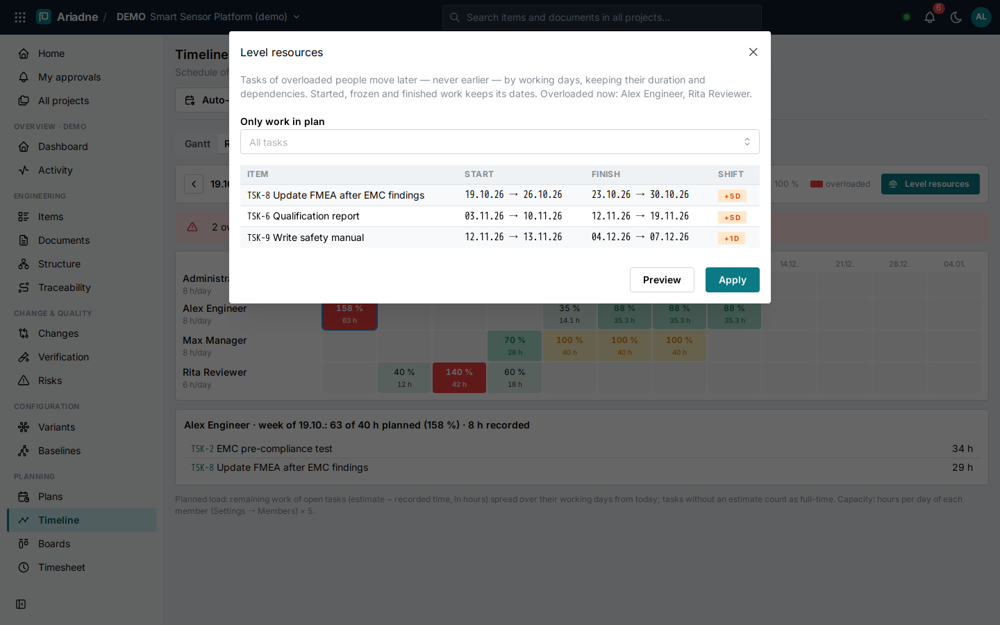

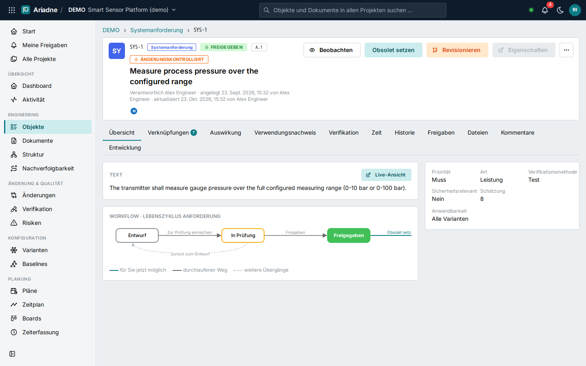

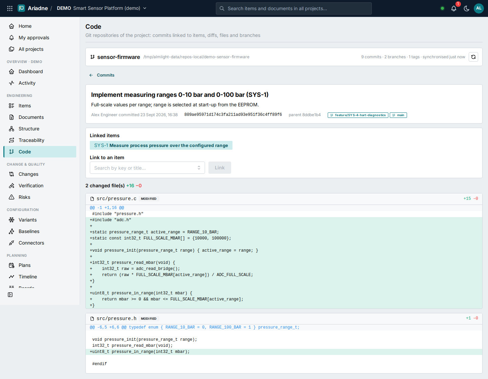

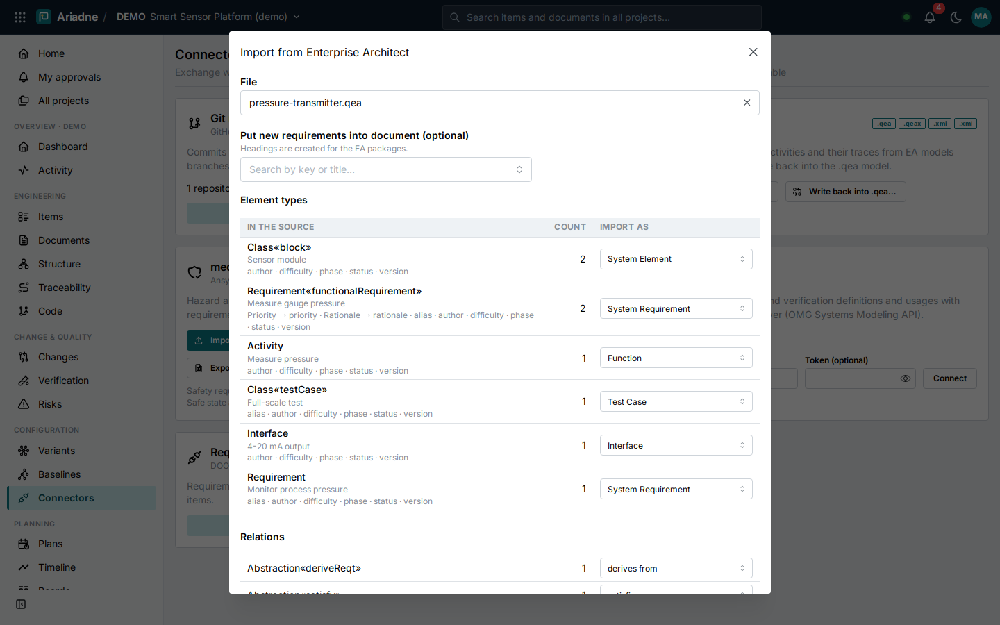

## Highlights

- **Live co-editing**: several people edit the same text at the same time with live cursors and names; presence
  shows who is in a document and who edits which block; pages refresh themselves when others save. Sessions are
  saved as ordinary versions with co-authors (explicitly, when the last editor leaves, or after idle time).
- **Rich text**: formatting, headings, lists, quotes, code, links, tables (merge/split cells), images by upload, paste
  or drag & drop, and `#` item references — identical in the editor, Word, PDF, ReqIF (`.reqifz`) and Excel.
- **Configurable information model**: item types, fields (also computed: formulas and classification bands), link
  types and workflows are defined in process templates (YAML), so each customer gets their own model without code
  changes; new template capabilities are taken over into existing projects additively.
- **Full history**: immutable versions (`A.1, A.2 … B.1`), diff and restore. Released revisions are frozen and
  changed through *Revise*.
- **Traceability**: typed links with rules, suspect links when a linked item changes, impact analysis, a trace
  matrix and coverage from stakeholder needs to test results.
- **Live documents**: specifications assembled from individually versioned items, with a release guard.
- **Workflows and approvals**: configurable lifecycles, approvals by role with the four-eyes rule and electronic
  signatures, and an approval inbox.
- **Change management**: problem report → change request (CCB) → change order. Change-controlled revisions, and
  releasing the change order releases its affected items.
- **Baselines**: of a whole project or one document or structure, using latest or released revisions, with compare.
- **Branching & merging**: branch a document for a variant or release and merge it back with a field-level 3-way
  merge in either direction.
- **Live documents with time travel**: open any document exactly as it was at any change point or baseline, open any
  item version, and compare revisions, baselines, branches or other documents side by side with word-level
  differences. Also: Word round trip (reviewers edit and comment in Word, changes and comments come back), threaded
  comments, variant-specific views, automatic numbering, reuse, recycle bin and release collections.
- **Variants**: feature model with constraints, product variants, and applicability expressions on items and links,
  plus a configurator.
- **Verification**: test cases with steps, step-by-step execution with actual results, defects from failed steps,
  test runs pinned to versions, JUnit import from CI, re-test detection, and maturity per system element
  (specified / realised / verified / validated).
- **Risk management (FMEA)**: severity, occurrence, detection, computed RPN and risk level, risk matrix before and
  after mitigation, mitigation traceability and residual-risk acceptance with e-signature.
- **Queries like Polarion**: query builder with chips for any field, link, date, user or plan (*is / is not*,
  Any/None, periods), OR/AND groups across fields with NOT, a query language to copy, paste and edit, configurable
  columns incl. custom fields, sorting, a preview pane, and saved views with their columns.
- **Bulk edit**: select rows or the whole result and edit fields or owner, change the status, plan, link, watch or
  delete — with a per-item preview of what will change and what is skipped and why.
- **Kanban boards**: any items, columns and swimlanes by status, owner, plan, type or field, WIP limits; dragging a
  card runs the real workflow transition (with comment or e-signature when required).
- **Plans**: releases with iterations and milestones, estimates against capacity, burn-up and burn-down, and a
  planning board to drag work from the backlog into iterations.
- **Timeline (Gantt)**: tasks, milestones and plans with finish-to-start, start-to-start, finish-to-finish and
  start-to-finish dependencies with lag, critical path, scheduling conflicts and schedule-baseline comparison; drag
  bars to reschedule, or auto-schedule along the dependencies with a preview.
- **Time and resources**: record hours on items, a weekly timesheet with spent and remaining effort, resource load
  per person and week against capacity, and resource levelling with a preview.
- **Code (Git) like Polarion**: connect GitHub, GitLab, Bitbucket, Azure Repos or any Git server; commits that
  mention an item key become linked revisions of the item (or are linked by hand); a repository browser with
  commits, diffs, files and branches; GitHub pull requests; a branch per item in one click.
- **Connectors**: Enterprise Architect (import `.qea`/XMI with mapping and GUID identity, export EA XMI, write back
  into the `.qea`), medini analyze (HARA with ISO 26262 ASIL and FMEA both ways, safety requirements via ReqIF) and
  SysML v2 servers (SysON, Cameo) — every import previewed, repeatable, conflicts reported instead of overwritten.
- **English and German**: the whole interface, the labels of the information model (translated per customer),
  server messages, notifications, e-mail digests and document exports follow the user's language.
- **Workflow viewer**: every item shows its state diagram with the path taken and the transitions possible now.
- **Bill of materials**: multi-level BOM with quantities, units, find numbers, date effectivity, rolled-up totals,
  Excel/CSV export and where-used across projects.
- **File management**: check-out/check-in with file revisions, revision history and preview; items with
  checked-out files cannot be released.
- **Notifications**: watch items and documents, @mentions, owner and approval notifications, live toasts and e-mail
  digests; bulk changes collapse into one summary.
- **Saved views**: personal and shared filters, traceability-gap filters (unverified, unallocated, unmitigated,
  unplanned) and export of exactly the current view.
- **Reports & KPIs**: end users build their own reports from KPI, chart, table, trend, coverage, matrix and
  maturity widgets, plus engineering KPIs: reuse rate per module, change lead time, re-test effort per variant and
  module variants vs. offered variants. Reports export to Excel and print to PDF; KPIs are also available as JSON.
- **Documents out & in**: Word and PDF export of documents, either live or exactly as frozen in a baseline, Word
  also in the customer's own corporate template. ReqIF import with a mapping wizard; re-importing an updated file
  updates the existing items instead of duplicating them.
- **Integration**: REST API (OpenAPI), API tokens, GitHub and Azure DevOps webhooks, signed outbound webhooks,
  CSV/Excel import/export, ReqIF export/import, and full project archives.
- **Compliance & identity**: hash-chained audit trail with verification, role-based access, single sign-on via
  OpenID Connect (Microsoft Entra ID, Keycloak), and secure defaults.

## Quick start

Requirements: Docker with Compose.

```bash
cp .env.example .env            # set POSTGRES_PASSWORD, ALMLIGHT_ADMIN_PASSWORD; ALMLIGHT_DEMO_DATA=true for the demo
docker compose up -d --build
```

Open <http://localhost:48080>. Sign in as `admin` with the password from `.env`; if it was left empty, the
generated password is in `docker compose logs app`. With demo data enabled, the users `alex` (contributor),
`rita` (reviewer) and `max` (manager) share the password `demo1234` and work in the project **DEMO**, a generic
smart-sensor product platform.

API documentation: <http://localhost:48080/api/v1/docs>

## Documentation

| | |
|---|---|
| [Product concept](docs/01-product-concept.md) | Vision, delivery model, users, capability map |
| [Research & best practices](docs/02-research-best-practices.md) | How leading suites and standards solve it; where SE is heading |
| [Reference input analysis](docs/03-reference-input-analysis.md) | Generic conclusions from the first customer workshop |
| [Domain model](docs/04-domain-model.md) | Items, versions, links, lifecycle, change, baselines, variants, verification |
| [Architecture](docs/05-architecture.md) | Building blocks, runtime, security, quality |
| [MVP scope & roadmap](docs/06-mvp-scope-roadmap.md) | What is built, what is prepared, what comes next |
| [Configuration guide](docs/07-configuration-guide.md) | Tailoring process templates per customer |
| [Operations](docs/08-operations.md) | Install, configure, back up, upgrade, develop |
| [API & integrations](docs/09-api-and-integrations.md) | REST API, CI, GitHub, Azure DevOps, webhooks, formats |
| [Live documents](docs/10-live-documents.md) | Feature parity with enterprise live documents, time travel |
| [Rich text & co-editing](docs/11-rich-text-and-co-editing.md) | Editor, images, live sessions, saving, formats, operation |
| [Engineering backbone](docs/12-engineering-backbone.md) | Notifications, views, computed fields, tests, risks, plans, BOM, files, Word templates, SSO |
| [Work management](docs/15-work-management.md) | Query builder and language, bulk edit, boards, plans, timeline, workflow viewer |
| [Feature catalogue](docs/13-feature-catalogue.md) | Ariadne compared with Polarion/Teamcenter capability areas |
| [Beta test report](docs/14-beta-test-report.md) | Method, findings and fixes, permission matrix, load test |
| [Languages](docs/16-languages.md) | German and English interface, translated models, server texts |
| [Code and connectors](docs/17-code-and-connectors.md) | Git repositories, linked revisions, Enterprise Architect, medini analyze, SysML v2 |
| [Azure Container Apps](docs/18-azure-container-apps.md) | Running Ariadne in an Azure resource group with company sign-in |
| [Architecture decisions](docs/adr/README.md) | ADR-0001 … ADR-0032 |

## Technology

Python 3.12 · FastAPI · SQLAlchemy 2 · Alembic · PostgreSQL 16 · pycrdt (Yjs) · React 19 · TypeScript · Mantine ·
TipTap · Yjs · TanStack Query · Vite · Docker. All dependencies are permissively licensed.

```
backend/   API, domain modules, migrations, tests (pytest against PostgreSQL)
frontend/  single-page application
e2e/       browser tests (Playwright)
docs/      concept, architecture, guides, ADRs
```

## Tests

```bash
docker compose -f compose.test.yaml run --rm backend-tests                      # 190 API/unit tests
docker compose -f compose.test.yaml up -d --build app && \
docker compose -f compose.test.yaml run --rm e2e                                 # 52 browser E2E tests
docker compose -f compose.test.yaml down
```

## Status

Version 0.8 (0.8.1 hardens sign-in and runs on Azure Container Apps, [guide](docs/18-azure-container-apps.md)): Git interface (linked revisions, repository browser) and connectors to Enterprise Architect, medini
analyze and SysML v2 servers ([guide](docs/17-code-and-connectors.md), sample files in `samples/`) — on top of 0.7
(boolean queries, dependency types and auto-scheduling, time recording, resources and levelling, German user
interface), 0.6 (query builder and
query language, bulk edit, Kanban boards, plans with capacity, Gantt timeline with critical path, workflow viewer),
0.5 (tests, risks, BOM, files, notifications, Word templates, SSO)
and 0.4 (rich text, real-time co-editing, live documents with time travel, branches, reports, Word/ReqIF round trips).
How it compares with Polarion and Teamcenter: [feature catalogue](docs/13-feature-catalogue.md). Next increments:
[roadmap](docs/06-mvp-scope-roadmap.md).
