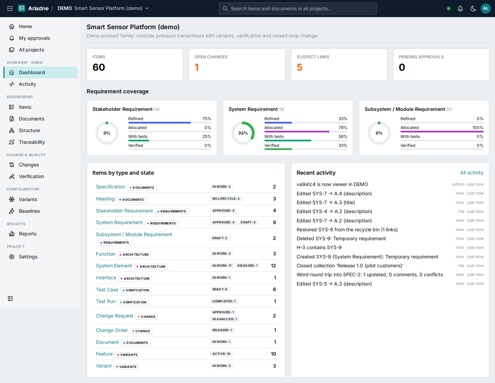

# ALMlight

**A lightweight, configurable engineering backbone (ALM/PLM) for small and medium-sized engineering companies.**

ALMlight connects requirements, architecture, verification, documents, variants and changes in one versioned,
traceable and auditable system. It adopts the proven concepts of enterprise suites (live documents, suspect links,
revisions and maturity states, closed-loop change management, baselines, feature-based variants) and delivers
them in two containers, without enterprise licence and operating costs.



## Highlights

- **Configurable information model**: item types, fields, link types and workflows are defined in process templates
  (YAML), so each customer gets their own model without code changes.
- **Full history**: immutable versions (`A.1, A.2 … B.1`), diff and restore. Released revisions are frozen and
  changed through *Revise*.
- **Traceability**: typed links with rules, suspect links when a linked item changes, impact analysis, a trace
  matrix and coverage from stakeholder needs to test results.
- **Live documents**: specifications assembled from individually versioned items, with a release guard.
- **Workflows and approvals**: configurable lifecycles, approvals by role with the four-eyes rule and electronic
  signatures, and an approval inbox.
- **Change management**: problem report → change request (CCB) → change order. Change-controlled revisions, and
  releasing the change order releases its affected items.
- **Baselines**: of a whole project or one document or structure, using latest or released revisions, with compare.
- **Branching & merging**: branch a document for a variant or release and merge it back with a field-level 3-way
  merge in either direction.
- **Variants**: feature model with constraints, product variants, and applicability expressions on items and links,
  plus a configurator.
- **Verification**: test runs pinned to versions, JUnit import from CI, re-test detection, and maturity per system
  element (specified / realised / verified / validated).
- **Integration**: REST API (OpenAPI), API tokens, GitHub and Azure DevOps webhooks, signed outbound webhooks,
  CSV/Excel import/export, ReqIF export, and full project archives.
- **Compliance**: hash-chained audit trail with verification, role-based access, and secure defaults.

## Quick start

Requirements: Docker with Compose.

```bash
cp .env.example .env            # set POSTGRES_PASSWORD, ALMLIGHT_ADMIN_PASSWORD; ALMLIGHT_DEMO_DATA=true for the demo
docker compose up -d --build
```

Open <http://localhost:48080>. Sign in as `admin` with the password from `.env`; if it was left empty, the
generated password is in `docker compose logs app`. With demo data enabled, the users `alex` (contributor),
`rita` (reviewer) and `max` (manager) share the password `demo1234` and work in the project **DEMO**, a generic
smart-sensor product platform.

API documentation: <http://localhost:48080/api/v1/docs>

## Documentation

| | |
|---|---|
| [Product concept](docs/01-product-concept.md) | Vision, delivery model, users, capability map |
| [Research & best practices](docs/02-research-best-practices.md) | How leading suites and standards solve it; where SE is heading |
| [Reference input analysis](docs/03-reference-input-analysis.md) | Generic conclusions from the first customer workshop |
| [Domain model](docs/04-domain-model.md) | Items, versions, links, lifecycle, change, baselines, variants, verification |
| [Architecture](docs/05-architecture.md) | Building blocks, runtime, security, quality |
| [MVP scope & roadmap](docs/06-mvp-scope-roadmap.md) | What is built, what is prepared, what comes next |
| [Configuration guide](docs/07-configuration-guide.md) | Tailoring process templates per customer |
| [Operations](docs/08-operations.md) | Install, configure, back up, upgrade, develop |
| [API & integrations](docs/09-api-and-integrations.md) | REST API, CI, GitHub, Azure DevOps, webhooks, formats |
| [Architecture decisions](docs/adr/README.md) | ADR-0001 … ADR-0013 |

## Technology

Python 3.12 · FastAPI · SQLAlchemy 2 · Alembic · PostgreSQL 16 · React 19 · TypeScript · Mantine · TanStack Query ·
Vite · Docker. All dependencies are permissively licensed.

```
backend/   API, domain modules, migrations, tests (pytest against PostgreSQL)
frontend/  single-page application
e2e/       browser tests (Playwright)
docs/      concept, architecture, guides, ADRs
```

## Tests

```bash
docker compose -f compose.test.yaml run --rm backend-tests                      # ~85 API/unit tests
docker compose -f compose.test.yaml up -d --build app && \
docker compose -f compose.test.yaml run --rm e2e                                 # browser E2E tests
docker compose -f compose.test.yaml down
```

## Status

Version 0.1, the MVP foundation. See the [roadmap](docs/06-mvp-scope-roadmap.md) for planned increments.
