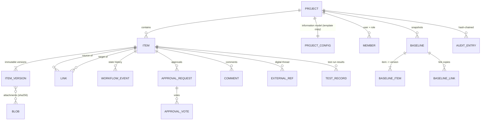

# 4 Domain model

## 4.1 Overview



## 4.2 Information model (configuration)

Each project holds a copy of a **process template** (see [configuration guide](07-configuration-guide.md)):

- **Item types** — key, label, key prefix (`SYS` → `SYS-12`), category (requirement, architecture, verification,
  change, document, variability, other), workflow, `change_controlled`, `document`, custom **fields**
  (string, text, integer, number, boolean, date, enum, multienum, tags, user, url; required, default, pattern).
- **Link types** — label and reverse label, allowed source/target types, `structural` (ordered hierarchy),
  `acyclic`, `suspect_on_target_change`, `editable_on_frozen_source`, link **attributes** (e.g. quantity).
- **Workflows** — states (category, `initial`, `frozen`, `released`, `implementation_open`) and transitions
  (allowed from-states, minimum role, comment required, direct e-signature, approval: roles × count, signature,
  four-eyes, reject target; guards; effects).
- **Semantics** — binds engine features to keys (affects, verifies, satisfies, derives, requires/excludes links;
  test case / test run / stakeholder / element types).

## 4.3 Items and versions

An **item** is any engineering object. The `items` row is the current state (denormalised for search);
every content change appends an immutable **item version**.

| Concept | Meaning |
|---|---|
| Key | Human-readable, per project and prefix: `SYS-12`; never reused |
| Revision | Formal generation `A, B, C …` (or `1, 2, 3`); a new revision starts with *Revise* |
| Iteration | Save within a revision: `A.1, A.2 …` |
| Version number | Monotonic per item (1, 2, 3 …) — used for optimistic locking and pinning |
| Head version | Current content |
| Released version | The version that was last released (stays valid while a new revision is in work) |
| Content | Title, Markdown description, custom fields, applicability expression, attachment list |
| Metadata | Owner, created/updated by/at — owner changes do not create versions |

Rules:

- Content can only change in non-frozen states (e.g. Draft / In Work). Frozen states lock the content.
- A released item is never edited: **Revise** creates the next revision in the initial state.
- **Change-controlled** types can only be revised under a change order that is *in work* and lists the item as
  affected. All iterations of that revision are attributed to the change order.
- Restoring an old version creates a new iteration with the old content (history is never rewritten).
- Released items cannot be deleted (make them obsolete); other deletes are soft deletes.

## 4.4 Links and traceability

A **link** is typed and directed. Convention: **the source depends on the target**
(`TC-3 verifies SYS-2`, `SE-5 satisfies MRQ-1`, `SYS-1 derives from STK-1`). A link belongs to its source:
a frozen source cannot gain or lose links (unless the link type allows it).

- **Suspect links**: when the target's content changes, links of types with `suspect_on_target_change` become
  suspect until a user confirms them — the dependent item must be reviewed.
- **Structural links** (`contains`) are ordered (float positions) and build documents, product structures and the
  feature tree. An element may be used in several parents (reuse), even across projects.
- **Impact analysis** follows dependency links backwards (transitively) and adds the *where-used* chain along
  structural links.
- Links can carry attributes (quantity) and an applicability expression (variant-specific structure).

## 4.5 Lifecycle, approvals and signatures

The state of an item is lifecycle metadata, not content: transitions do not create versions but are recorded as
**workflow events** (status accounting) and in the audit trail.

- **Guards** block a transition until a condition holds: `contained_items_released`, `has_affected_items`,
  `affected_items_revised`, `all_records_executed`.
- **Effects** run after a transition: `release_affected_items` (closed-loop change).
- **Approvals**: requesting a transition with an approval creates a request pinned to the current version; N users
  with the required role vote; the requester cannot approve (four-eyes) unless configured; a rejection needs a
  comment and can move the item back. Any content or state change invalidates pending approvals.
- **Electronic signature**: password re-entry; the meaning ("Approved: Approve of SYS-4 A.1") is stored with the vote.

## 4.6 Change management (CMII-light)

```
Problem report ──escalates to──▶ Change request ◀──implements── Change order
        │                       │ affects (items)               │ affects (items, action = revise/add/obsolete)
        ▼                       ▼                               ▼
  analysis             impact analysis, CCB approval     revise affected items under the CO
                                                         submit (guard: all revised) → approve → release
                                                         effect: affected items released / obsoleted
```

## 4.7 Baselines

A **baseline** is an immutable snapshot of item versions (and states) plus copies of the links, for the whole project
or a sub-tree (a document or product structure). Revision rules: *latest* (working state) or *released* (latest
released revision; unreleased items left out). Baselines can be compared with each other or with the current state
(added / removed / changed items with field diffs, link changes).

## 4.8 Variants (150% model)

- **Features** are items with a unique `code`, a kind (mandatory/optional) and a child group (none / alternative /
  or), arranged in a tree via structural links; cross-tree constraints are `requires` / `excludes` links.
- **Variants** are items whose `selection` lists feature codes; they are validated against the feature model.
- **Applicability**: items and links can carry a boolean expression over feature codes
  (`OUT_HART and (SIL2 or SIL3) and not EX`). Empty = applies to all variants.
- **Resolve**: a selection filters the 150% model to the items and links of one configuration (100%).

## 4.9 Verification and maturity

- Test cases `verify` requirements, elements, functions or interfaces.
- A test run holds **test records**: one result per test case, pinned to the executed test case version.
- Verification status of an item: `passed` (all latest results passed on current versions, no suspect link),
  `retest` (results outdated), `failed`, `not_run`, `none`. Variant-specific via the run's variant field.
- **Maturity per element**: specified (allocated requirements released), realised (element released), verified
  (allocated requirements passed), validated (upstream stakeholder needs passed).

## 4.10 Audit trail

Every mutation writes an audit entry (actor, action, entity, summary, details, related item ids). Each entry stores
the SHA-256 of its canonical content and the previous entry's hash; `GET /admin/audit/verify` recomputes the chain
and reports the first broken entry.
