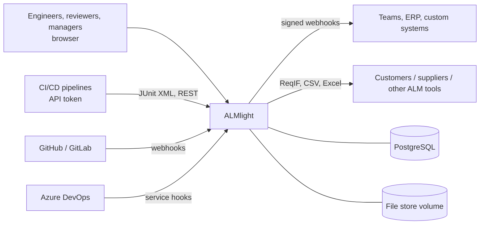

# 5 Architecture

## 5.1 Context



## 5.2 Runtime view

One application container (Python, FastAPI) serves the REST API under `/api/v1`, the OpenAPI documentation and the
single-page frontend; a PostgreSQL container stores all data. Files live in a content-addressed volume.

```
┌──────────────────────── app container ────────────────────────┐
│  Uvicorn / FastAPI                                             │
│   ├─ /api/v1/*      REST API (OpenAPI at /api/v1/docs)          │
│   ├─ /hooks/*       inbound integrations (shared-secret auth)   │
│   ├─ /*             React SPA (static build)                    │
│   └─ outbox worker  delivers domain events to webhooks          │
└─────────────────┬──────────────────────────────┬──────────────┘
                  │ SQLAlchemy (psycopg 3)        │ /data volume
           ┌──────▼──────┐                 ┌──────▼──────┐
           │ PostgreSQL  │                 │ files/ab/cd │
           └─────────────┘                 └─────────────┘
```

Start-up: wait for the database → `alembic upgrade head` → bootstrap the first administrator → (optional demo data)
→ start the outbox worker.

## 5.3 Building blocks (modular monolith)

```
backend/almlight/
  core/            config, database, errors, security, auth dependencies, shared schemas
  modules/
    projects/      projects, members, roles, information model (metamodel + templates)
    identity/      users, sessions, API tokens, bootstrap admin
    items/         items, versions, revisions, fields, attachments, comments, search
    links/         links, suspect propagation, structure, impact analysis, trace matrix
    workflow/      workflow engine, guards, effects, approvals, e-signatures
    baselines/     snapshots, compare
    variants/      expressions (parser), feature model, validation, 150% resolve
    verification/  test records, JUnit import, verification status, coverage, maturity
    io/            CSV/Excel, ReqIF export, project archive
    integrations/  external refs, GitHub / Azure DevOps hooks, outbound webhooks, outbox
    audit/         hash-chained audit trail
  seed/            demo dataset
frontend/src/      React + TypeScript (Mantine UI, TanStack Query)
```

Each module has `models.py` (SQLAlchemy), `service.py` (domain logic, transactions boundaries are the request),
`router.py` (HTTP + Pydantic schemas). Routers call services; services call other modules' services, never their
routers. Every mutation writes its audit entry and outbox event **in the same transaction**.

## 5.4 Key technical decisions

See the [ADRs](adr/). In short:

| Topic | Decision |
|---|---|
| Style | Modular monolith, API-first ([ADR-0001](adr/0001-modular-monolith-fastapi.md)) |
| Storage | PostgreSQL only: JSONB fields, full-text search, recursive queries ([ADR-0002](adr/0002-postgresql-only.md)) |
| Versioning | Immutable item versions with revision/iteration ([ADR-0003](adr/0003-immutable-item-versions.md)) |
| Configuration | Process templates as data + semantics ([ADR-0004](adr/0004-configurable-metamodel.md)) |
| Traceability | Typed links owned by the source, suspect on target change ([ADR-0005](adr/0005-typed-links-suspect.md)) |
| Baselines | Explicit snapshots with revision rules ([ADR-0006](adr/0006-baselines-as-snapshots.md)) |
| Change | CMII-light, release via change order ([ADR-0007](adr/0007-cmii-light-change.md)) |
| Variants | Features as items + applicability expressions ([ADR-0008](adr/0008-variants-150-model.md)) |
| Delivery | One image, SPA served by the API, Docker-only toolchain ([ADR-0009](adr/0009-single-image-delivery.md)) |
| Security | Local users, cookie sessions, API tokens; OIDC later ([ADR-0010](adr/0010-authentication.md)) |
| Branching | Change-scoped revisions now; document branches later ([ADR-0011](adr/0011-branching-strategy.md)) |
| Integration | Webhooks in/out, external refs, outbox ([ADR-0012](adr/0012-integration-strategy.md)) |
| Audit | Hash-chained audit trail ([ADR-0013](adr/0013-hash-chained-audit.md)) |

## 5.5 Security

- Passwords hashed with Argon2; minimum length; same error for unknown user and wrong password.
- Browser sessions: signed JWT in an httpOnly, SameSite=Lax cookie (`Secure` behind HTTPS); API: personal access
  tokens (`Bearer alm_…`), stored as SHA-256 hashes, revocable, expiring.
- Authorisation: project membership with roles viewer < contributor < reviewer < manager; administrators act as
  managers. Non-members get 404 (projects are not enumerable).
- Security headers on every response (CSP `default-src 'self'`, `frame-ancestors 'none'`, nosniff, referrer policy);
  `Cache-Control: no-store` on the API.
- Markdown is rendered without raw HTML (no XSS through descriptions); uploaded files are served as attachments.
- Inbound webhooks: HMAC-SHA256 signature (GitHub) or shared secret (Azure DevOps), constant-time comparison.
  Outbound webhooks are signed with a per-hook secret. Secrets are generated by the server and shown once.
- XML input (JUnit) is parsed with `defusedxml`; uploads are size-limited and streamed.
- No secrets in the repository: configuration via environment variables / `.env` (gitignored); the session key is
  generated and persisted in the data volume if not supplied.

## 5.6 Quality and testing

- Backend: ~85 pytest tests against a real PostgreSQL (migrations applied by Alembic), covering API flows and
  negative cases (permissions, frozen states, validation, conflicts, signature failures, tampering detection).
- Frontend: strict TypeScript; Playwright browser tests (login, item lifecycle, approvals with e-signature,
  traceability, documents, structure, variants, baselines, permissions) run against a fresh stack with demo data.
- Lint: ruff. Everything runs in Docker (`compose.test.yaml`).

## 5.7 Scalability and limits

The MVP targets teams of up to a few dozen users and tens of thousands of items per installation:

- Audit writes are serialised by an advisory lock (linear hash chain) — fine for SME write volumes.
- Recursive queries (impact, trees, cycles) are bounded by depth and use indexed link columns.
- Horizontal scaling is possible (stateless app; the outbox worker uses `SKIP LOCKED`), but not needed initially.
- Files are de-duplicated by content hash; large binary CAD data should stay in the PDM system and be referenced.
