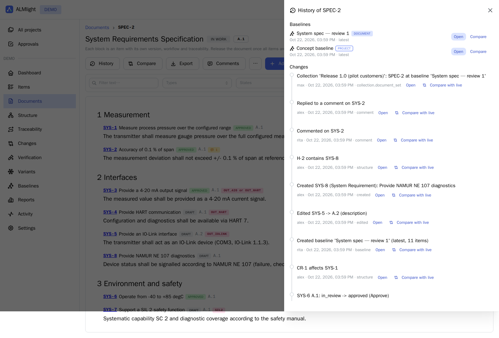
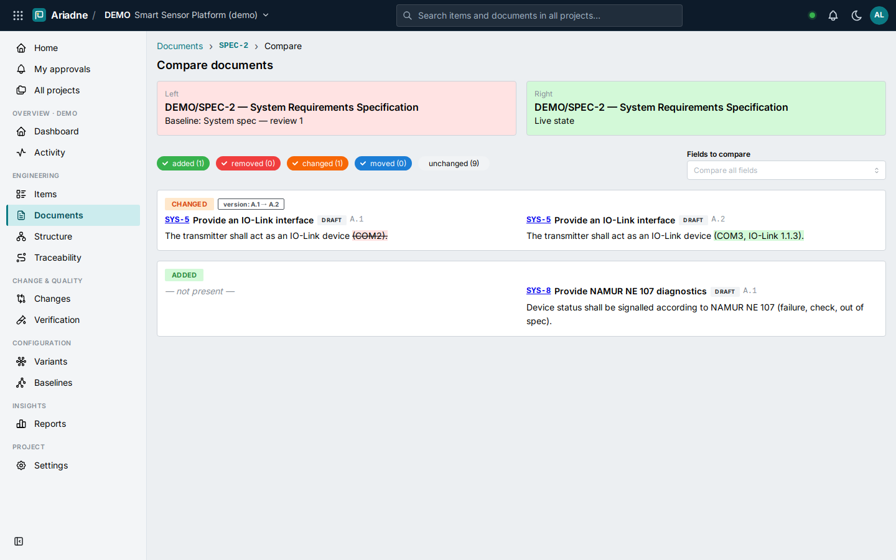

# 10 Live documents — feature parity with enterprise ALM

Ariadne's documents follow the *live document* idea of enterprise ALM suites (e.g. Polarion LiveDocs): a document is
an ordered outline of individually versioned, traceable items with workflow. Before building the 0.3 increment we
checked the published feature set of such suites (release notes, help pages and feature descriptions; see sources).
This page maps those capabilities to Ariadne.

| Capability | Typical enterprise ALM | Ariadne |
|---|---|---|
| Document = outline of work items | LiveDoc with work items, headings, free text | ✔ Document items with ordered structural links; headings; rich text per item |
| Automatic heading numbering | ✔ | ✔ 1, 1.1, 1.1.1 in view, Word and PDF (switchable) |
| Document history / revisions | every change is a revision; open any revision | ✔ document history timeline (content, structure, lifecycle, comments, baselines); **open the document as of any change point** (read-only, exact texts, versions, states, outline) |
| Item history / versions | ✔ | ✔ revision.iteration versions, diff, restore; **open any version read-only** with older/newer navigation |
| Document baselines | named document revisions | ✔ one-click document baselines; open, compare, export |
| Project baselines | ✔ | ✔ (since 0.1), revision rules latest/released |
| Collections | sets of document revisions/baselines, closing freezes, reopen with permission | ✔ collections of document baselines; close (freeze), only managers reopen; export as PDF/Word zip |
| Compare revisions | revision vs revision, baseline vs baseline, current vs baseline | ✔ any two states: live / point in time / baseline |
| Compare documents | branched vs master, documents in other projects | ✔ branch vs master, any other document (also cross-project); items paired by identity, branch relation, ReqIF identity or title; word-level diff, moves, field selection |
| Branching & merge | branch documents, 3-way merge | ✔ (0.2) field-level 3-way merge, both directions |
| Reuse | items referenced in several documents | ✔ insert an existing item into a document (one item, one history); "reused" indicator |
| Word round trip | export for reviewers without tool access, re-import edits and comments | ✔ review copy (edit or comments-only), re-import with 3-way conflict detection, Word comments (incl. replies, resolved) → document comments |
| Excel round trip | ✔ | ✔ CSV/Excel import updates by key (dry run, all-or-nothing) |
| ReqIF round trip | exchange with suppliers/OEMs | ✔ import with mapping and update-on-reimport; **export keeps the partner's original identifiers** |
| Word / PDF export | with templates | ✔ title page, TOC, attributes, traces — live, at a point in time, from a baseline, per variant |
| Document comments | threads, replies, resolve, show resolved | ✔ threaded comments with resolve/reopen, document-wide comment panel, badges per block |
| Document filter | filter content by query | ✔ text, type and state filter in the document view |
| Variants in documents | variant specifications | ✔ variant filter (100% view) and variant-specific Word/PDF export |
| Document workflow & signatures | approvals, e-signatures | ✔ document lifecycle with release guard (all items approved), approvals, four-eyes, e-signature |
| Suspect links in documents | ✔ | ✔ suspect badge per block |
| Recycle bin | restore deleted items | ✔ restore deleted items with their links and document position |
| Collaboration notifications | who has the document open, who is editing, who saved (pushed, no refresh) | ✔ presence avatars per document and item, orange marker on blocks being edited, live refresh and "… changed the document" notifications |
| Concurrent editing | save-based editing; concurrent changes merged on save | ✔ **real-time co-editing** of the same text with live cursors and names (CRDT, no locks); saved as one version with co-authors; read-only for viewers and frozen items |
| Rich-text editor with tables and images | ✔ (rich text fields, tables, images) | ✔ formatting, headings, lists, quotes, code, alignment, links, tables (rows/columns, header, merge/split), images by upload, paste or drag & drop, `#` item references — and the same content in Word, PDF, ReqIF and Excel |

## How the time travel works

Everything a past view needs is immutable or versioned: item contents are `ItemVersion` rows, lifecycle states are
`WorkflowEvent` rows, and **structural links are closed and re-created on every change** (validity interval
`created_at`–`deleted_at`). Opening a document "as of T" therefore reconstructs exactly the outline, the item versions
and their states at T — not an approximation. Baseline views read the baseline's frozen tables.

See [11-rich-text-and-co-editing](11-rich-text-and-co-editing.md) for how co-editing and rich text work.

## Sources

- Polarion ALM 19.2 — document baselines: https://blogs.sw.siemens.com/polarion/polarion-alm-19-2-whats-new-and-noteworthy/
- Polarion ALM 2404 — compare view, auto-merge: https://blogs.sw.siemens.com/polarion/polarion-alm-2404-whats-new-and-noteworthy/
- Polarion ALM 20 R2 — collections: https://blogs.sw.siemens.com/polarion/polarion-alm-20-r2-whats-new-and-noteworthy/ ; https://blogs.sw.siemens.com/polarion/a-deeper-dive-into-collections/
- Word round trip and document comments: https://blogs.sw.siemens.com/polarion/10-tips-for-polarion-livedocs-9-use-document-comments-for-word-round-trip/
- Comments and threads (help): https://docs.plm.automation.siemens.com/content/polarion/20/help/en_US/user_and_administration_help/user_guide/work_with_documents/comments_and_threads.html
- About baselines (help): https://docs.plm.automation.siemens.com/content/polarion/19.1/help/en_US/user_and_administration_help/user_guide/baselines/about_baselines.html
- Community diff tool (compare documents across projects): https://extensions.polarion.com/extensions/476-diff-tool
- Polarion ALM 21 R1 — collaboration notifications in LiveDocs: https://blogs.sw.siemens.com/polarion/polarion-alm-21-r1-whats-new-and-noteworthy/
- Polarion ALM 21 R2 — editing/saving indicators: https://blogs.sw.siemens.com/polarion/polarion-alm-21-r2-whats-new-and-noteworthy/
- Polarion rich text (tables in rich text fields, table row/column editing): https://blogs.sw.siemens.com/polarion/whats-new-and-noteworthy-in-polarion-2015-sr3/
