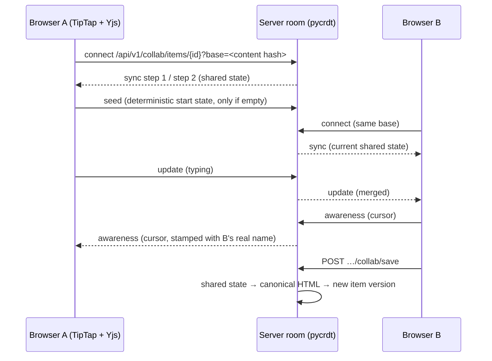

# 11 Rich text and live co-editing

Item texts are **rich text** (formatting, lists, tables, images, links, item references), and several people can
**edit the same text at the same time**, seeing each other's changes and cursors instantly. Every saved state is
still an ordinary, immutable item version with audit trail, suspect-link marking and webhooks.

## 11.1 What users get

| Feature | How it works |
|---|---|
| Rich-text editor | Bold, italic, underline, strike, highlight, code, sub/superscript, headings, bullet/numbered lists, quotes, code blocks, rules, alignment, links, tables (insert, rows/columns, header row, merge/split cells), undo/redo |
| Images | Toolbar upload, paste from the clipboard or drag & drop (PNG, JPEG, GIF, WebP). Images are stored once and referenced; old versions and baselines always show the image they were saved with |
| Item references | Type `#` and pick an item: a reference chip (`SYS-12`) that navigates to the item and travels into Word, PDF and ReqIF |
| Live co-editing | Open *Edit text* on an item or double-click a block in a document. Everybody editing the same item works in one shared text; changes merge character by character, nothing is locked |
| Live cursors & names | Each participant's caret is shown with name and colour; the editor header lists who is editing |
| Presence | Avatars show who is in a document or on an item and who is editing which block (orange marker on the block) — the collaboration notifications known from enterprise live documents |
| Live refresh | Pages refresh themselves when somebody saves, transitions or links something; documents show a notification "Rita changed the document: …" |
| Saving | *Save version* creates a new version now; *Done* saves and closes; leaving without saving saves automatically when the last editor has left (after a few seconds). The version records the co-authors ("Live co-editing with Rita, Max") |
| Safety | Viewers and frozen items get a read-only live view. A workflow transition first saves the session, so the reviewed/released version contains the latest text. Sessions survive a server restart (drafts are saved every two seconds and recovered on start) |

## 11.2 How saving relates to versions

Typing does **not** create a version per keystroke. A live session holds the shared text; it becomes a version
when someone saves, when the last editor leaves (grace period `ALMLIGHT_COLLAB_LEAVE_GRACE_SECONDS`, default 8 s, so
a page reload does not create a version) or after `ALMLIGHT_COLLAB_IDLE_SECONDS` (default 300 s) without changes.
Saving an unchanged text creates no version.

Anything that changes the text *outside* the session — the properties dialog, a restore, a Word/ReqIF/Excel import,
a branch merge — first saves the session (so nothing typed is lost; optimistic locking then reports the conflict to
the form user) and afterwards restarts the session from the new text. The browser reloads and reconnects on its own.

## 11.3 Rich text in every format

All inputs are parsed into one content model and written back by one serialiser (ADR-0018). The same text
therefore always has the same stored form, and every output format reads the same model:

| Format | Rich text |
|---|---|
| REST API | `description` accepts HTML (sanitised) or Markdown/plain text (converted); responses return canonical HTML |
| Word export / round trip | Paragraphs, headings (styles `ALM Heading n`, not in the table of contents), marks, links, item references, lists with restarted numbering, quotes, code, rules, images and tables with merged cells. The round trip reads all of it back: unchanged text is never a change |
| PDF export | Same content with fonts, lists, tables (spans, header shading) and images |
| ReqIF | XHTML with formatting, lists, tables, links; images as `xhtml:object` in a `.reqifz` archive. Import reads `.reqifz` images (also the PNG fallbacks DOORS writes) |
| Excel / CSV | Markdown in the description cell; a cell that was not edited leaves the rich text untouched |
| Project archive | Format 2 stores HTML and lists the referenced images; format-1 archives (Markdown) are converted on import |

Sanitising is by construction: only known elements, attributes and URL schemes are written (no scripts, event
handlers, `javascript:` links, styles other than text alignment, external images). The browser sanitises again
before rendering.

## 11.4 How co-editing works (technical)

- **Protocol**: the standard y-websocket protocol (sync and awareness messages), so the browser uses the stock
  Yjs WebSocket provider. The server keeps the authoritative document with pycrdt (Yrs), relays updates and
  enforces access: updates from read-only participants are dropped, presence carries the authenticated user's
  name and colour regardless of what the client sends, cross-site connections are refused.
- **Start state**: each client builds the start document from the item version it loaded, with a Yjs client id
  derived from the content hash. Seeds from several clients are therefore byte-identical and merge into one; a
  client whose loaded text is outdated is told to reload (close code 4409).
- **Saving**: the server converts the shared document (ProseMirror nodes as Yjs XML) into canonical HTML and saves
  it through the normal item service. Drafts (`collab_drafts`) make sessions crash-safe.
- **Live channel**: one more WebSocket per browser tab (`/api/v1/live`) carries change events from the audit trail
  (published only after commit; dry runs never leak) and presence.

## 11.5 Operating notes

- Live sessions run in the application process; run **one app container** (the default). Larger installations
  that need several app processes would add a shared message bus (Postgres `LISTEN/NOTIFY` or Redis) — the room
  manager is the only component that needs it.
- Reverse proxies must forward WebSocket upgrades for `/api/v1/collab/` and `/api/v1/live` and pass the original
  `Host` (or `X-Forwarded-Host`). See [Operations](08-operations.md#88-reverse-proxy-and-websockets).
- Settings: `ALMLIGHT_MAX_IMAGE_MB` (15), `ALMLIGHT_COLLAB_LEAVE_GRACE_SECONDS` (8),
  `ALMLIGHT_COLLAB_IDLE_SECONDS` (300), `ALMLIGHT_COLLAB_DRAFT_SAVE_SECONDS` (2).
- Upgrading from 0.3 converts existing Markdown texts to rich text once (migration `c4e1d2f3a5b6`).

## 11.6 Compared with enterprise live documents

Enterprise live documents show who has a document open and whether others are editing or have saved (presence and
collaboration notifications) and merge concurrent structural edits; editing itself is still save-based. Ariadne
offers the same presence and refresh behaviour **and** character-level real-time co-editing with live cursors —
the editing model users know from modern office tools — while keeping the ALM guarantees (immutable versions,
frozen states, approvals, audit trail).
