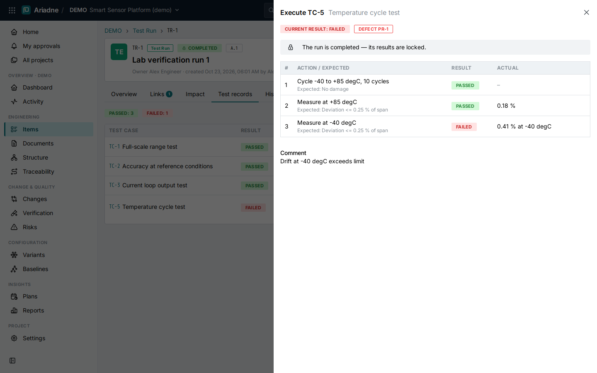
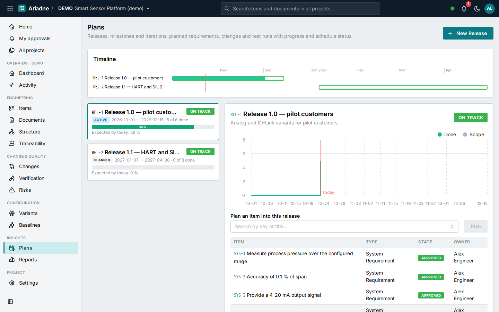
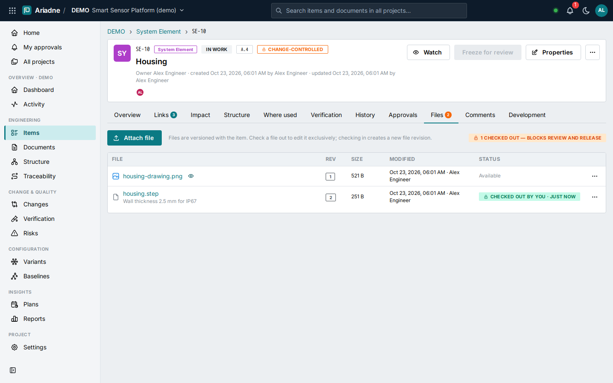

# 12 Engineering backbone (0.5)

Version 0.5 closes the gaps between Ariadne and the enterprise ALM/PLM suites in the areas SMEs use daily:
staying informed, finding gaps, executing tests, managing risks, planning releases, managing the bill of materials
and files, and producing documents in the corporate design. Everything is built on the generic item/link/workflow
model (see [ADR-0023](adr/0023-backbone-features-on-the-generic-model.md)), so it stays configurable per customer.

| Area | What users get | Where |
|---|---|---|
| [Notifications](#121-notifications-watching-and-mentions) | Watch items/documents, @mentions, approval and owner notifications, live toasts, e-mail digests | Bell in the header, *Watch* on items and documents, account page |
| [Saved views](#122-saved-views-traceability-gaps-and-export) | Personal and shared filters, traceability-gap filters, export of the current view | *Items* → *Views*, *Export* |
| [Computed fields](#123-computed-fields-and-bounds) | Formulas (e.g. RPN) and classification bands, min/max limits, live preview in forms | Information model |
| [Test execution](#124-step-by-step-test-execution-and-defects) | Test steps, step-wise execution with actual results, defect from a failed step | Test cases, test runs → *Test records* |
| [Risk management](#125-risk-management-fmea) | FMEA risks with S/O/D, RPN and level, mitigation links, risk matrix before/after mitigation | *Risks* |
| [Release planning](#126-release-planning) | Releases/milestones with timeline, progress, schedule status, burn-up; planning items | *Plans* |
| [Bill of materials](#127-bill-of-materials-effectivity-and-where-used) | Multi-level BOM with quantities, units, find numbers, effectivity, roll-up, Excel/CSV, where-used | *Structure* → *BOM*, item tab *Where used* |
| [File management](#128-file-management-check-out-and-check-in) | Check-out/check-in, file revisions with history, preview, release blocked while checked out | Item tab *Files*, home page |
| [Word templates](#129-word-templates-corporate-design) | Export documents into the customer's own .docx/.dotx template | *Settings* → *Import / Export*, document *Export* |
| [Single sign-on](#1210-single-sign-on) | OpenID Connect (Entra ID, Keycloak, Okta) with PKCE, user provisioning, admin group | Sign-in page; [operations](08-operations.md#single-sign-on-oidc) |
| [Template updates](#1211-template-updates) | New template capabilities taken over into existing projects, additively | *Settings* → *Information model* |

## 12.1 Notifications, watching and mentions

**Who is notified** (the person who made the change never is):

| Kind | Recipients |
|---|---|
| watch | everyone watching the changed item **or a document/structure that contains it** (any depth) |
| owner | the owner of an item that was edited, revised, transitioned, commented, got files, or got a test result |
| approval | members whose role may vote when an approval is requested |
| mention | users named as `@username` in a comment (members of the project or administrators) |

- *Watch* sits in every item and document header; the home page lists what you watch.
- The **bell** shows unread notifications; clicking one opens the item and marks it read; *Mark all read*.
- Mentions and approval requests also pop up as **live toasts** in every open browser of the recipient.
- Typing `@` in a comment suggests users; e-mail-like user names from single sign-on work too.
- **Bulk changes collapse**: one transaction (import, merge, change-order release) that would send a person more than
  five notifications sends one summary ("1500 changes in PERF by admin") instead. Dry runs notify nobody.
- **E-mail digests** when SMTP is configured: one mail per user with the unread notifications, at most every minute;
  users switch them off on their account page.

## 12.2 Saved views, traceability gaps and export

- *Views* on the item list saves the current search, type, states, traceability-gap filter and release filter —
  personal, or shared with the team (contributors and above). The menu shows the current hit count of each view.
  Owners and managers can delete shared views.
- **Traceability-gap filters**: *Not verified by a test*, *Not derived from a parent requirement*, *Not allocated*,
  *Risk without mitigation*, *Not planned in a release* (offered when the model has the link type). The API
  generalises this: `link_type`, `link_dir` (`in`/`out`) and `link_exists` (`true`/`false`).
- *Export* delivers exactly the **current view** (all pages, not only the visible one) as Excel or CSV, in the same
  column format as the import.

## 12.3 Computed fields and bounds

Field definitions in the information model can now be calculated:

```yaml
- {key: severity, label: Severity (S), type: integer, min: 1, max: 10}
- {key: rpn, label: Risk priority number (RPN), type: integer, formula: "severity * occurrence * detection"}
- key: risk_level
  type: enum
  options: [{key: low, label: Low}, {key: medium, label: Medium}, {key: high, label: High}]
  classify: {field: rpn, bands: [[1, low], [80, medium], [200, high]]}
```

- `formula`: arithmetic over other numeric fields (`+ - * / // %`, parentheses, `min`, `max`, `abs`, `round`).
  Formulas are validated when the model is saved (only known fields, no other functions or names).
- `classify`: an enum value from the last band whose threshold is ≤ the value.
- `min` / `max`: limits for numbers, enforced by the API with a clear message.
- Computed values are recalculated on every save; input for them is ignored. Forms show them read-only and update
  them **while typing**.
- Field type `steps`: an ordered list of `{step, expected}` (used for test steps, up to 300 per item).

## 12.4 Step-by-step test execution and defects



- Test cases have **test steps** (action and expected result), edited in the item form and shown on the overview.
- In a test run (*Test records*), *Execute* opens the steps of the version under test: per step *Pass / Fail /
  Blocked / Skip* and the actual result, plus a comment. The record's result follows the steps: any failed →
  failed, else any blocked → blocked, all passed (or skipped) → passed, otherwise not run.
- **Defect from a failed step**: creates a problem report quoting run, test case version, step, expected and actual
  result, linked to the test case and referenced from the record (one defect per record; the defect opens from the
  record). Requirements verified by the test case show *failed* in their verification status.
- Completed runs are read-only: the drawer explains why and shows the recorded results.

## 12.5 Risk management (FMEA)


- Item type **Risk** (`RSK`) with failure mode, effect, cause, severity, occurrence, detection, the computed **RPN**
  and **risk level**, mitigation text and the ratings after mitigation (residual RPN and level).
- Links: `mitigated by` (requirements, elements, functions, test cases — suspect when they change) and `risk for`
  (functions, elements, interfaces).
- Lifecycle: Open → Mitigated → Accepted (approval by reviewer or manager with e-signature), reopen, obsolete.
- **Risks** page: KPIs (total, high, high without mitigation, high residual, accepted), the **risk matrix**
  severity × occurrence before and after mitigation — cell colours by S×O, the count bubble coloured by the worst
  RPN level in the cell — click a cell to filter the register; the register sorted by RPN with mitigation count.

## 12.6 Release planning



- Item type **Release** (`REL`) with start, due date and goal; lifecycle Planned → Active → Done / Cancelled.
- Requirements, elements, test cases, test runs, problem reports, change requests and change orders are planned with
  the `planned in` link (also when frozen: planning does not change the item).
- **Plans** page: a timeline with month axis and today line, per release the progress (items in a released/closed
  state), the expected progress by today and a schedule status — *on track*, *at risk* (more than 15 points behind
  the time elapsed), *overdue*, *done*. The detail shows a **burn-up** (done vs. scope per day) and the planned items;
  items are planned from there. The item list filters by release.

## 12.7 Bill of materials, effectivity and where-used


- The structural `contains` link carries **quantity** (≥ 0), **unit**, **find number** and **effectivity**
  (*effective from / until*).
- *Structure* → **BOM**: the multi-level BOM (`.1`, `..2` levels) with find number, revision, state, quantity, unit,
  **rolled-up total quantity** and effectivity; *Effective on* shows the BOM valid on a date; quantities and
  effectivity are edited in place (in parents that are not frozen); export to **Excel/CSV** (with path and totals).
- **Where used** on every element: all paths up to the top-level products and documents, with the quantity per
  parent — also in other projects that reuse the element.

## 12.8 File management: check-out and check-in



Files attached to an item are versioned with the item (content-addressed). For files edited outside the browser —
CAD models, Office documents, reports — Ariadne now works like a PDM vault:

- **Check out** a file (with an optional note): nobody else can replace or remove it until it is checked in or the
  check-out is cancelled (by the holder or a project manager — audited as forced).
- **Check in** uploads the new content as the next **file revision** (1, 2, 3 …) with a comment; it creates a new
  item iteration, marks dependent links suspect, and ends the check-out.
- **Revision history** per file with downloads of every revision; images preview in the browser, PDFs open in a tab
  (other types — including SVG — always download).
- Items with checked-out files **cannot be frozen** (submitted for review, released, or released by a change
  order); frozen items' files cannot be checked out. The home page lists *Checked out by me*.

## 12.9 Word templates (corporate design)

Managers upload Word templates (`.docx` or `.dotx`, up to 10 MB, no macros) per project; *Sample template*
downloads a starting point. When exporting a document to Word, users choose the layout. In a template:

| Placeholder | Filled with |
|---|---|
| `{{title}}` `{{key}}` `{{version}}` `{{state}}` | the document |
| `{{project}}` `{{project_name}}` | the project |
| `{{source}}` `{{variant}}` | live state / baseline / point in time; the variant or *all variants* |
| `{{date}}` `{{author}}` `{{product}}` | export date, exporting user, *Ariadne* |
| `{{toc}}` (alone in a paragraph) | a table of contents |
| `{{content}}` (alone in a paragraph) | the document: introduction and items (without it: appended at the end) |

Placeholders work in body, tables, headers, footers and text boxes, also when Word split them into several runs.
Heading, list and table styles the template lacks are copied in from the standard layout (with list numbering), so a
cover page with a logo is enough to start; templates that define *Heading 1–9*, *List Bullet/Number* and table
styles get their own look. The Word round trip (review copies) works with templates too. PDF export keeps the
standard layout.

## 12.10 Single sign-on

OpenID Connect with the authorization code flow and PKCE; the ID token is verified against the provider's keys.
Users are created on their first sign-in (or only matched, if sign-up is off); members of a configured group become
administrators; project roles remain managed in Ariadne. Local accounts keep working as a fallback. Setup:
[operations](08-operations.md#single-sign-on-oidc).

## 12.11 Template updates

When a newer process template ships new capabilities (0.5: risks, releases, test steps, BOM attributes and the new
link types and workflows), *Settings → Information model* shows the additions and a manager takes them over with one
click. The update is **additive only** — it never changes or removes the project's own types, fields, states or
links, and it is validated against the existing data like any model change.
